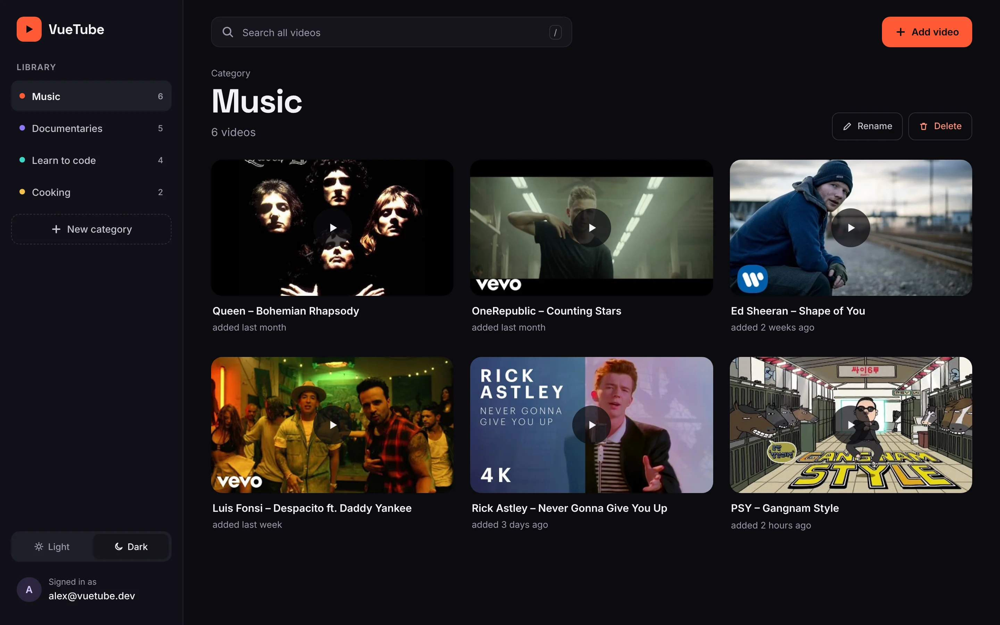
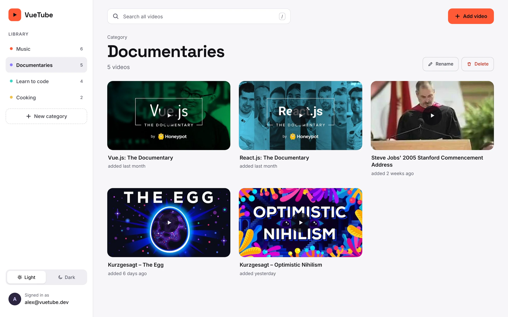
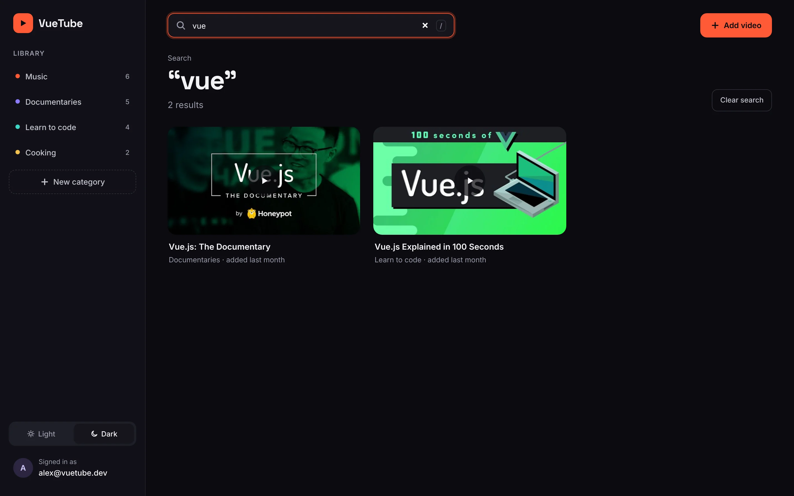
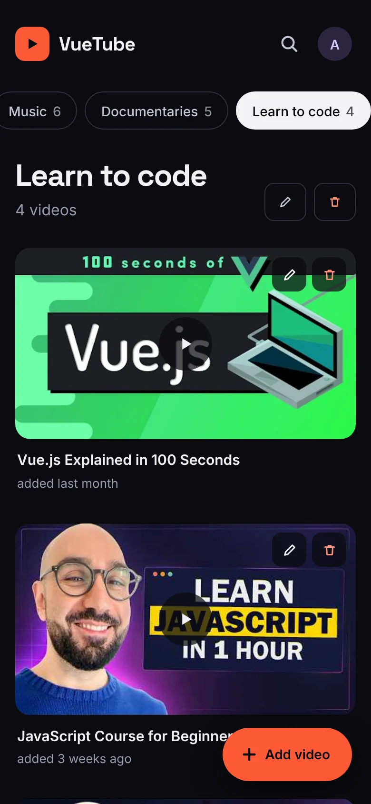
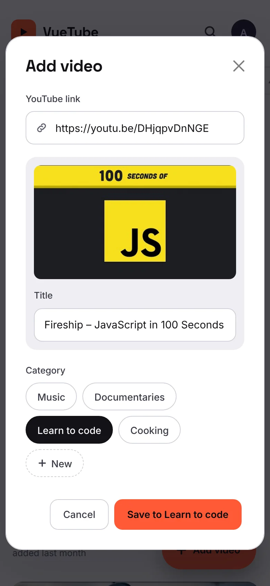
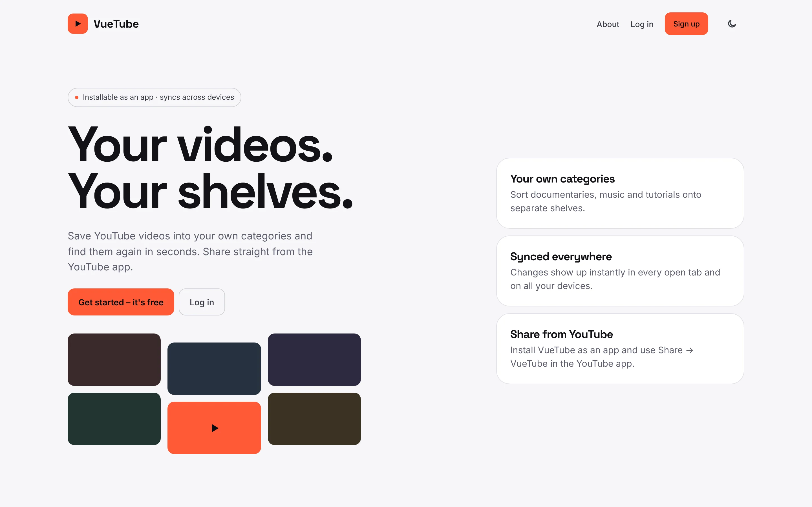

# VueTube
Save your favourite YouTube videos in your own categories and find them again in seconds.

VueTube started as a project to learn and practice Vue.js and Firebase. It is built with **Vue 3**, **Vite**, **Pinia**, **Vue Router**, **bootstrap-vue-next** (Bootstrap 5) and **Firebase** (Auth + Firestore), and can be installed as a PWA.

**Live demo:** https://vuetube-1199b.firebaseapp.com/



## Features
- **Your own categories**: sort music, documentaries and tutorials onto separate shelves. Rename categories, edit video titles and move videos between categories.
- **Search** across all your videos, and see when each one was added.
- **Real-time sync**: changes show up instantly in every open tab and on all your devices.
- **Fast dashboard**: videos show a thumbnail and only load the YouTube player when you click play.
- **Share from YouTube**: install VueTube as an app, then use *Share → VueTube* in the YouTube app.
- **Dark and light theme**, a sidebar on desktop and swipeable category chips on phones.
- **Forgot your password?** Request a reset link by email from the login page.
- **Private by default**: Firestore security rules make sure every user can only see and change their own videos.

## 📸 Screenshots

| Light theme | Search across categories |
|---|---|
|  |  |

<p align="center">
  
  &nbsp;&nbsp;
  
</p>

<p align="center"><em>On the phone: category chips, and a video shared from the YouTube app with the “Add video” dialog already filled in.</em></p>



## Config
Copy `.env.example` to `.env.local` and fill in your web app's Firebase configuration
(Firebase console → Project settings → Your apps).

The Firestore security rules live in [`firestore.rules`](firestore.rules) and are deployed together with the app.

## Build Setup
Requires Node.js 22.12+.

``` bash
# install dependencies (exactly the versions from package-lock.json)
npm ci

# serve with hot reload at localhost:5173
npm run dev

# build for production with minification
npm run build

# preview the production build locally
npm run preview

# run the unit tests / the linter
npm test
npm run lint

# test the Firestore security rules (starts the Firestore emulator, needs Java)
npm run test:rules

# build & deploy hosting and Firestore rules on firebase
npm run deploy
```

### Local development with the Firebase emulators
Set `VITE_FIREBASE_EMULATORS=true` in `.env.local` (any `VITE_FIREBASE_PROJECT_ID` starting with `demo-` works without a real project) and run:

``` bash
npx firebase emulators:start --project demo-vuetube
```

CI (GitHub Actions) runs lint, unit tests, the build and the security rule tests on every pull request.

### Troubleshooting
**`Cannot find native binding` when running `vite build`**: npm skipped the platform-specific build tools, which mostly happens when `node_modules` was installed on top of an older setup. Reinstall from scratch with `rm -rf node_modules && npm ci`. Also check `node -v` (22.12+ required) and that `node -p "process.arch"` matches your machine (`arm64` on Apple Silicon).
