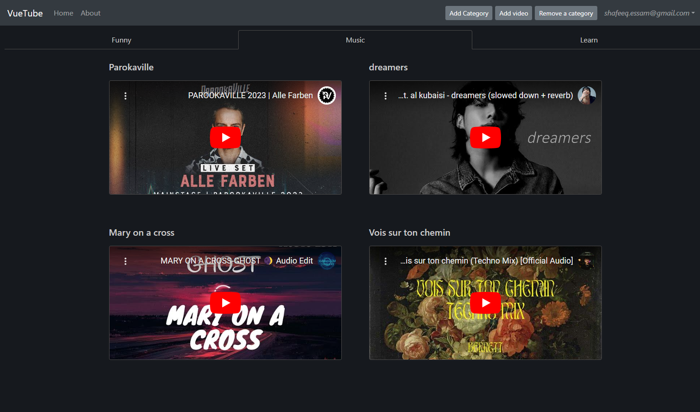

# Vuetube
Vuetube is a simple project to learn and practice Vue.js, Pinia state management, Bootstrap 5, and Firebase.
In this app you can save videos in categories to find them quickly later.

Built with **Vue 3**, **Vite**, **Pinia**, **Vue Router**, **bootstrap-vue-next** (Bootstrap 5) and **Firebase** (Auth + Firestore). It can be installed as a PWA.

## Features
- Save YouTube videos in your own categories; rename categories, edit video titles and move videos between categories
- Changes sync in real time across all your open tabs and devices
- Fast dashboard: videos show a thumbnail and only load the player when you click play
- Share videos straight from the YouTube app: install VueTube as an app, then use *Share → VueTube*
- Dark mode, swipe between categories on touch screens

## Demo
https://vuetube-1199b.firebaseapp.com/


## Config
Copy `.env.example` to `.env.local` and fill in your web app's Firebase configuration
(Firebase console → Project settings → Your apps).

The Firestore security rules live in [`firestore.rules`](firestore.rules) and are deployed together with the app.


## 📸 Screenshots



## Build Setup
Requires Node.js 22.12+.

``` bash
# install dependencies
npm install

# serve with hot reload at localhost:5173
npm run dev

# build for production with minification
npm run build

# preview the production build locally
npm run preview

# run the unit tests / the linter
npm test
npm run lint

# test the Firestore security rules (starts the Firestore emulator, needs Java)
npm run test:rules

# build & deploy hosting and Firestore rules on firebase
npm run deploy
```

### Local development with the Firebase emulators
Set `VITE_FIREBASE_EMULATORS=true` in `.env.local` (any `VITE_FIREBASE_PROJECT_ID` starting with `demo-` works without a real project) and run:

``` bash
npx firebase emulators:start --project demo-vuetube
```

CI (GitHub Actions) runs lint, unit tests, the build and the security rule tests on every pull request.
